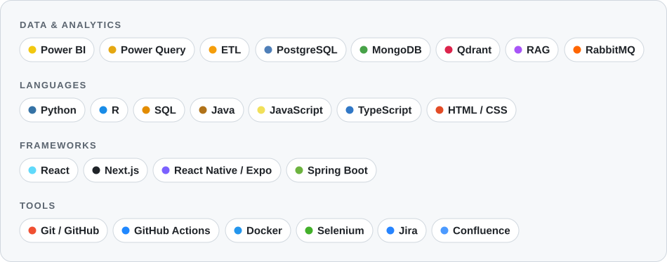

  &nbsp;
  &nbsp;
  

### 👋 About me

- 📊 **Data analyst.** Nearly two years at **Deutsche Börse (EEX)** building Power BI reports, ETL processes in Power Query, and Jira and Confluence analytics.
- 🎓 **MSc Data Science & AI** at HSLU in Lucerne, after a First Class BSc in Software Engineering at Lancaster University.
- 🎮 **Side projects I'm proud of:** [Cliptrove](https://github.com/Orio-03/Cliptrove), a free clip library for gamers, and [Sawa](https://sawa-app.ch/), an app that turns your mood into a real-life plan with friends.
- 🏕️ **Off the clock:** camper van, campfire, s'mores, and usually an idea for a dashboard.
- 🌍 Based in Switzerland · English, German, Arabic

### 🎬 Featured projects

  
  

### 🧰 What I work with

<picture>
  <source media="(prefers-color-scheme: dark)" srcset="assets/stack-dark.svg">
  <source media="(prefers-color-scheme: light)" srcset="assets/stack-light.svg">
  
</picture>

Thanks for tuning in 🎧

